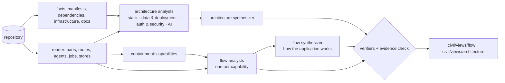

# Interpretation: flow and architecture

Owner's direction, 2026-10-14. Civil reads a codebase into two graphs that answer
different questions, beside the composition (`app.yaml`, the master list of parts):

- **Flow — how the application thinks.** The roles the application is made of and
  what passes between them: a user's intent is read by an intent agent, handed to an
  orchestrator, which picks agents; a harness constrains them; the outcome is saved;
  the intent agent checks the response still answers the intent; tools fire; a
  response comes back. Nodes are **roles**, not files. One role may span several
  modules; one module may play several roles. Loops are allowed — a check that sends
  work back is a loop, and the place a check is missing is the place a loop could go.
- **Architecture — what it is built on, and why.** The frontend's shape and framework,
  the backend framework and its structure, the database, queues and storage, the auth
  model, the security model, the AI subsystem, hosting. Nodes are **technical
  pieces and cross-cutting concerns**, each carrying the **decisions** that define it.

Both are views in the sense of prd-deltas §21: they live under `civil/views/<id>/`,
reference the composition's parts, and never change them. Generation reads only the
master. They differ from a grouping view in shape: a flow or architecture view is a
set of **diagrams**.

## The documents

```
civil/views/flow/view.yaml            kind: View, shape: flow, entry: overview
civil/views/flow/overview.yaml        kind: Diagram — how the application works, end to end
civil/views/flow/<flow>.yaml          kind: Diagram — one path, e.g. "an order is placed"
civil/views/architecture/view.yaml    kind: View, shape: architecture, entry: overview
civil/views/architecture/overview.yaml
```

A Diagram holds nodes and edges:

- **node** — `id`, `kind`, `name`, `summary` (one sentence), `realizedBy` (the
  composition parts that implement it), `evidence` (`path:line`), `decisions`
  (`statement`, `why`, `evidence`, `source: code | docs`), `ref` (another diagram of
  the view to step into), `confidence`.
- **edge** — `from`, `to`, `kind`, `label` (what passes, in a few words), `evidence`.

The node kinds are closed per shape, as PRD §3 keeps every vocabulary closed:

| Flow node | Means | Architecture node | Means |
|---|---|---|---|
| `actor` | a person or outside system that starts or receives | `client` | an app people use |
| `trigger` | a schedule, queue message, event or webhook | `service` | a backend that serves requests |
| `agent` | a model making a judgement | `worker` | a backend that runs background work |
| `orchestrator` | routes or plans work across agents | `datastore` | where state is kept |
| `guard` | a harness: approval, policy, validation, limits | `queue` | where work waits |
| `step` | deterministic work | `external` | a third-party service or provider |
| `tools` | a library of actions an agent may call | `platform` | hosting, infrastructure, CI |
| `store` | state read or written | `concern` | a cross-cutting model: auth, security, AI governance, observability |
| `output` | what a person receives | | |
| `flow` | another flow, to step into | | |

Edges: flow `next` (work passes on; the label says what) and `uses` (reads, writes,
calls a tool — dashed); architecture `uses`, `calls`, `hosts`, `governs`.

## How Civil reads them



1. **Deterministic first.** The reader's parts, and a fact sheet built without a model:
   each package's framework and notable libraries (by dependency name), the
   infrastructure resources Terraform declares, Dockerfiles, and the docs that exist.
   Analysts are given these so they spend their reads on judgement, not inventory.
2. **Architecture analysts**, one per concern — stack and structure; data and
   deployment; auth and security; the AI subsystem. Each reads code and docs and
   proposes nodes, edges and decisions, every one with evidence. A **synthesizer**
   merges them into one diagram, keeping each node once.
3. **Flow analysts**, one per capability (the containment areas of docs/lift-repo.md):
   each traces the capability's paths from its triggers (routes, screens, jobs) to its
   outcomes and writes one flow diagram, naming roles by what they do and saying for
   each agent whether it is one call or a tool loop, whether its output is validated,
   and whether anything checks it before a person sees it. A **synthesizer** reads the
   capability flows and writes the overview: how the application works end to end,
   each capability a `flow` node to step into, the shared roles (an assistant, an
   orchestrator, a harness, a tool library) drawn once.
4. **Checked twice.** Every piece of evidence is checked mechanically (the file exists,
   the line exists, the quote is there); then a verifier per diagram, shown the claims
   without their evidence, supports or refutes each. A refuted node or edge is dropped;
   an unchecked one is marked low confidence. Nothing is drawn on the model's word alone.
5. **Remembered.** Each analyst's answer is memoised on what it was shown, so an Update
   over unchanged code asks nothing again.
6. **Laid out.** Flows left to right by the order work passes, loops drawn back;
   architecture with clients left, services and workers in the middle, data and
   externals right, concerns above.

## On the canvas

The view switch lists every view. A diagram view opens at its entry diagram; a node
with `ref` is a door to another diagram. Edge labels say what passes. The inspector
shows a node's summary, decisions, evidence, and the parts that realise it.
